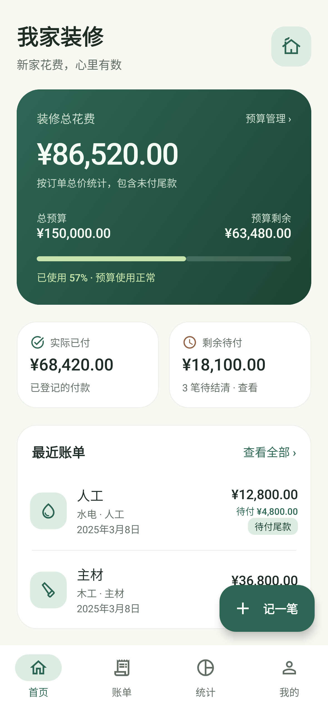
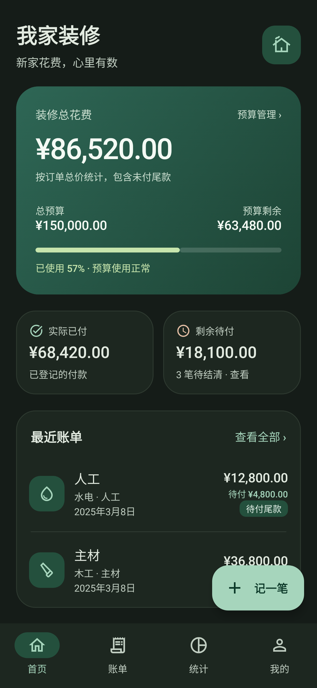
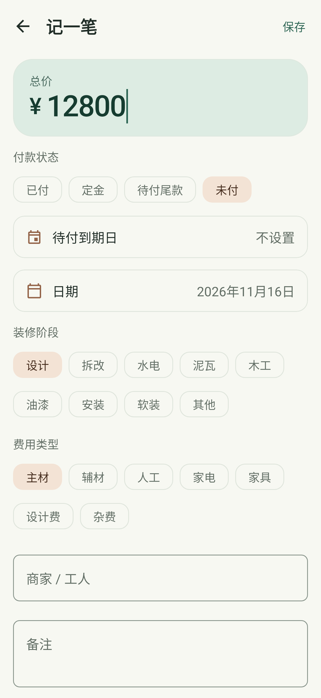
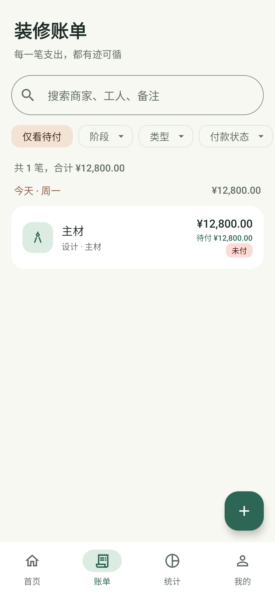
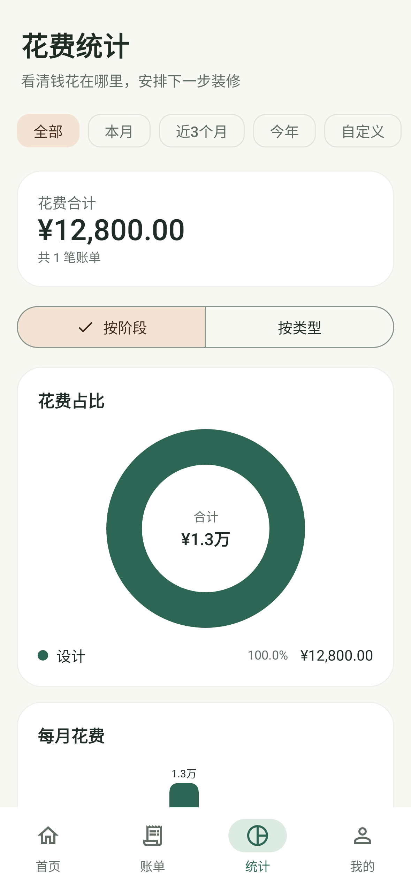
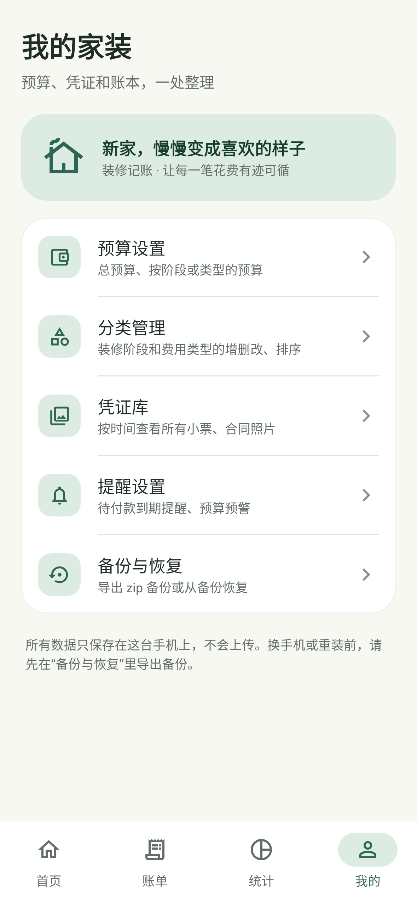
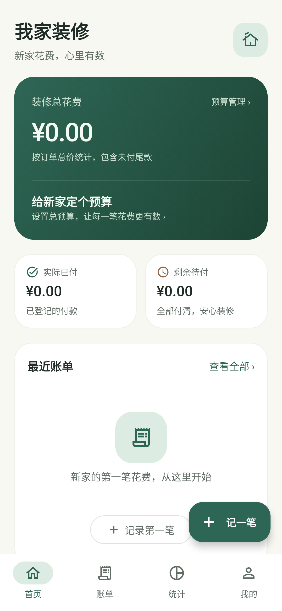
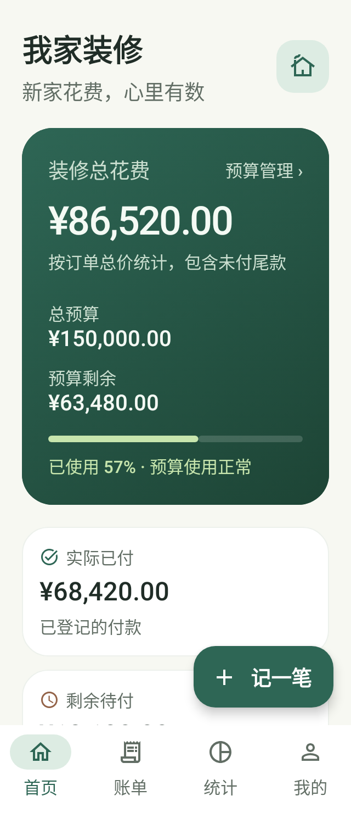

# 1.0.3 界面预览

以下为 Compose 界面在 Robolectric Android 图形环境中渲染的截图，并非设计示意图。首页的预算金额为测试数据；记账、待付筛选、统计和设置页面来自自动化操作实际 Activity 的流程。没有执行真机覆盖安装。

| 首页 · 浅色 | 首页 · 深色 |
| --- | --- |
|  |  |

| 记一笔 | 待付账单 |
| --- | --- |
|  |  |

| 花费统计 | 我的家装 |
| --- | --- |
|  |  |

| 空账本 | 小屏 · 130% 字体 |
| --- | --- |
|  |  |

小屏和大字体时预算明细、付款卡片纵向排列，金额保持完整显示；页面可上下滚动。
