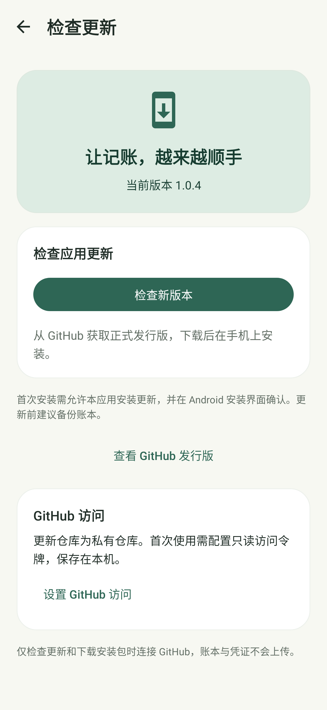
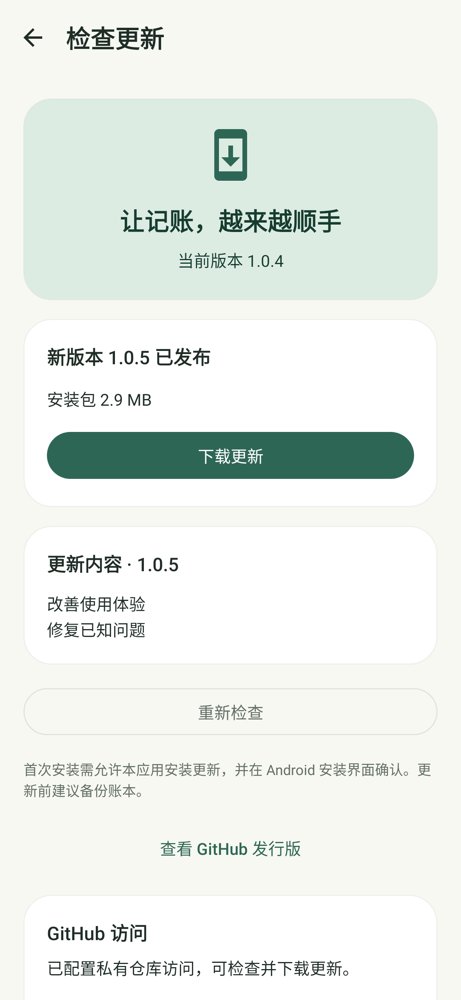
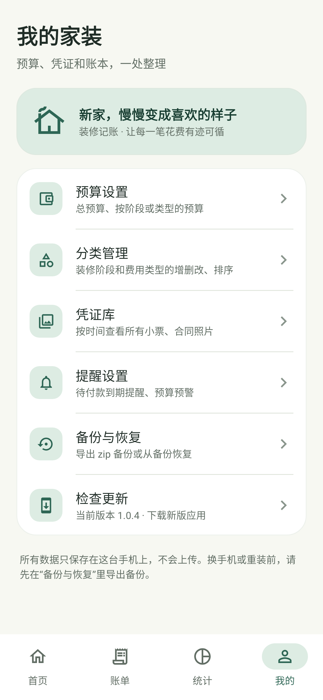

# 1.0.4 应用内更新

入口：“我的 → 检查更新”。用户主动检查版本，查看更新内容后下载，校验完成后点击“安装更新”，交给 Android 系统确认安装。首次安装需要允许“装修记账”安装应用。

## 实现

- GitHub Releases 的 `releases/latest` 提供正式版本信息；忽略草稿和预发布版本。
- 标签使用 `v主版本.次版本.修订版本`，按数字比较，避免把 1.0.10 判断成比 1.0.9 更旧。
- 选择与版本号完全匹配的 `renovation-ledger-版本号-signed.apk`，不选择 debug 或未签名包。
- 显示下载进度，支持取消和重试；网络请求在后台线程执行。下载随更新页面的 ViewModel 取消，离开此页后可重新检查并下载。完整且有效的缓存包可以复用。
- 校验 GitHub 提供的 SHA-256 和文件大小，再核对 APK 包名、递增的 versionCode、versionName、安装要求和当前应用的签名证书；不接受降级或换签名的安装包。
- 安装前再次校验，通过仅限 `cache/updates/` 的 FileProvider 把文件交给系统。无需存储权限；不进行静默安装。
- 仅通过 HTTPS 连接指定 GitHub 仓库及 GitHub 附件域名，限制跳转次数、超时、元数据和下载大小。授权信息不会转发给附件域名。
- 不上传账本或凭证，不改变 Room 数据库结构。

## 更新源与发布状态

更新源为私有仓库 `a1070503737-dev/code`，保留仓库私有属性。首次使用时，在“GitHub 访问”中设置自己的只读访问令牌；应用验证能够访问发行版后再保存，并检查是否有更新。

创建令牌：打开 GitHub Settings → Developer settings → Personal access tokens → Fine-grained tokens，只选择 `a1070503737-dev/code`，设置 Repository permissions → Contents → Read-only；Metadata 维持默认只读。不要授予写入权限。令牌过期或撤销后，在应用内替换即可，也可随时移除本机访问设置。

令牌使用 Android Keystore 的 AES-GCM 密钥加密保存在应用私有空间，不进入 SavedInstanceState、账本备份、源码或 APK。输入窗口隐藏令牌并禁止截图；认证仅发送到本仓库的 GitHub API，不转发给附件下载域名。应用内没有开发者的 GitHub 令牌。

使用与 1.0.3 相同的密钥签名。1.0.4 的 versionCode 为 5，可以覆盖本次新签名的 1.0.3；旧版 1.0.2 的临时签名仍无法覆盖。1.0.3 本身没有更新入口，需要手动安装一次 1.0.4，以后可通过应用内检查更新。

## 后续发布约定

1. 递增 versionCode 与语义版本号，继续使用本次保存的签名密钥。
2. 创建正式 Release，标签例如 `v1.0.5`，上传 `renovation-ledger-1.0.5-signed.apk`，等待附件状态变为 uploaded，并确认 GitHub 返回 SHA-256 digest。
3. 将该版本设为 Latest；预发布版本不会用于应用内更新。
4. 核验下载文件的校验和、签名和版本，保留真实设备覆盖升级的账本与凭证验证步骤。

## 检查范围

自动化测试包含实际 Activity 导航到更新页面、下载与安装按钮状态、进度与取消、版本比较、发行版选择、缺失校验信息、非受信任下载地址、下载截断或损坏、取消后的清理，以及不同包名、版本或签名的拒绝。

另外验证令牌加密往返、错误密钥拒绝解密、下载重定向不携带认证，以及未设置访问令牌时进入配置界面。

Robolectric 预览使用 1.0.5 演示更新状态，不代表已经发布 1.0.5。尚未执行真实手机安装、Android Keystore 实机验证或系统权限往返测试。私有仓库不提供匿名下载，用户仍需在手机上配置自己的只读令牌。

## 界面预览与验证结果

| 检查更新 | 有新版本（演示） | 我的页面 |
| --- | --- | --- |
|  |  |  |

- 2026-11-17：73 项自动化测试通过，0 失败、0 错误、0 跳过。
- Android lint：0 错误，6 条建议（原有备份规则、资源目录、测试依赖建议，以及两条 SharedPreferences KTX 写法建议）。
- 使用已授权身份通过 GitHub 附件 API 实际下载 1.0.3 APK，核对 SHA-256 一致，确认私有附件下载接口可用。该连接身份未嵌入应用。
- 真正的安装和系统权限确认仍由 Android 执行；此次未做真机测试。

正式 APK 已沿用 1.0.3 的签名，版本号 4 → 5，更新元数据和 ZIP 对齐校验通过。[签名验证记录](SIGNING-VERIFICATION-1.0.4.txt)。

APK SHA-256：`4b06b0653dfa34af479daad0d77102bff62cfa021c965cb7232947ed1643566c`
