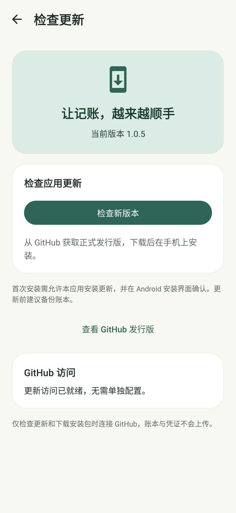

# 1.0.5 共享更新访问

> 后续更正：仓库当前为公开仓库。1.0.5 的无条件授权请求可能因令牌被拒绝而返回 401；请使用 [1.0.6 修正版](UPDATE-1.0.6.md)。此前云端访问成功借助了环境的仓库权限，不能独立证明上传令牌在手机上有效。以下内容保留为 1.0.5 的原设计和交付记录。

继续使用私有仓库 `a1070503737-dev/code`。正式包加入仓库所有者提供并授权分发的专用只读访问令牌，让安装此包的用户无需逐个配置令牌即可检查和下载更新。

使用方式：安装本次 1.0.5，进入“我的 → 检查更新”，点击“检查新版本”。发现新版本后查看说明、下载并点击“安装更新”。首次安装需允许本应用安装更新，再由 Android 确认；无需输入 GitHub 令牌。发行版网页本身仍需要 GitHub 登录，维护者可直接转发 APK 文件供首次安装。

## 令牌要求

- 在 GitHub 创建 Fine-grained personal access token，Repository access 仅选择 `a1070503737-dev/code`。
- Repository permissions 的 Contents 设置为 Read-only，Metadata 保持默认只读，不授予写入或管理权限。
- 使用单独的更新令牌，不能使用当前开发连接凭据或其他有更广权限的令牌。
- 令牌会进入 APK，可被持有 APK 的人提取；同一个令牌也能读取此私有仓库内它获准读取的源码。失效或撤销后，所有使用此内置令牌的客户端都会失去更新访问，需要维护者提供新的安装包。
- 私有发行版网页本身仍需要登录。首次使用者需要从维护者获得 APK 文件；安装之后可使用内置的访问权限更新。

## 打包

将令牌单独保存到仓库外的文本文件，通过路径显式传入：

```sh
./gradlew assembleRelease -PledgerUpdateTokenFile=/private/path/ledger-update-token.txt
```

只为 release 构建生成内置访问字段，debug 构建始终不包含此令牌。不读取 GH_TOKEN 或 GITHUB_TOKEN，也不把令牌写入版本控制中的源码文件。生成的 BuildConfig 和 APK 包含该值，因此只能分发受控的构建产物，不应公开构建缓存或日志。

若没有传入文件，仍保留 1.0.4 的手动访问设置，不能把这种构建当作已完成的共享访问版本发布。

内置访问优先于设备上的旧令牌，旧设备本地加密密钥失效也不会阻塞共享访问。内置访问版本隐藏逐用户令牌设置；令牌失效时提供联系维护者或手动下载的提示。下载地址限制、签名、版本和文件校验保持不变。

版本号为 1.0.5 / 6。正式交付仍使用 1.0.3、1.0.4 相同的签名密钥，包名 `com.zhuangxiu.ledger`、Room v1 均不变。本次新签名版本可覆盖 1.0.3 或 1.0.4；原始 1.0.2 的临时签名仍无法覆盖。

## 后续发布

继续使用当前签名密钥，递增 versionName、versionCode。正式打包时通过上述文件参数注入专用令牌；令牌原文件、签名私钥与密码不放进 Git。若共享令牌被撤销，需要维护者提供换用新令牌的 APK。

创建正式 GitHub Release，标签例如 `v1.0.6`，附件命名为 `renovation-ledger-1.0.6-signed.apk`。确认上传完成、GitHub 返回 SHA-256 digest 后设为 Latest。应用只接收正式发行版，校验文件大小、SHA-256、包名、版本和签名后才允许安装。

## 已完成的准备检查

- 2026-11-17：77 项自动化测试通过，0 失败、0 错误、0 跳过；lint 0 错误。
- 覆盖旧令牌过期、本机加密存储无法读取、未内置令牌时保留原配置，以及共享访问界面不要求逐用户输入令牌。
- 用明确无效的测试值验证：只有 release 构建配置接收显式指定文件的值，debug 始终为空；随后已清空生成的 release 配置。未使用真实令牌、未生成共享访问 APK。
- 仓库所有者已提供专用 Fine-grained token。使用该上传令牌实际读取私有仓库的 Latest 发行版并下载 1.0.4 APK（3,020,392 字节），文件 SHA-256 与 GitHub 元数据一致。重定向到 GitHub 附件域名时未携带 Authorization。

尚未执行真实手机安装、权限往返或账本覆盖升级测试；自动化与 APK 元数据验证不等同于真机测试。

## 本次交付验证

77 项测试通过，0 失败、0 错误、0 跳过；lint 0 错误、6 条建议。正式构建通过文件参数接收所有者上传的令牌，确认 debug 配置不含该令牌；构建日志及源码不含令牌原文。



预览由 Robolectric 渲染共享访问状态；未执行真机安装测试。

正式包已使用现有密钥签名，1.0.3 / 1.0.4 → 1.0.5 的签名、包名、递增版本号及 ZIP 对齐检查通过。[签名验证记录](SIGNING-VERIFICATION-1.0.5.txt)。

APK SHA-256：`5a54dfd30fce9cd3a8df3eef075604f47841862b555fc3754319ecadd09cdee0`
