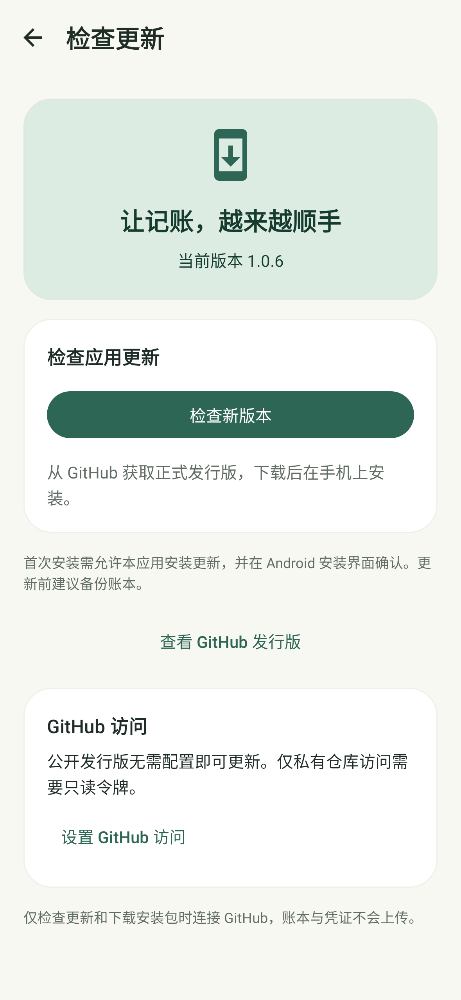

# 1.0.6 公开更新访问修复

用户录屏显示，1.0.5 检查更新后提示“更新服务授权已失效”。该提示对应客户端收到 HTTP 401。APK 内的令牌与上传文件一致，未发现漏写或截断。

排查时确认仓库 `a1070503737-dev/code` 当前为公开仓库。1.0.5 无条件携带内置凭据，凭据被拒绝时，公开发行版的检查也会失败。公开资源不需要用户提供令牌。

## 修复

- 检查版本和下载安装包都优先匿名访问 GitHub，不读取也不发送内置或本机令牌。即使旧令牌失效，公开更新也能正常使用。
- 仅在本仓库 API 的匿名请求返回 401、403 或 404，且用户有本机访问配置时，尝试一次带授权的请求。本次公开发行包不内置令牌，公开更新无需配置。
- 附件重定向始终不携带授权。没有凭据时不重复请求，不向不受信任的域名发送凭据。
- 不再要求先配置访问设置才能检查公开更新。访问卡片明确说明公开发行版无需令牌。
- 用户主动配置令牌时仍直接核验该令牌，不以匿名成功代替令牌核验。

## 更正此前验证结论

云端开发环境额外提供了 GitHub 连接权限。对照检查发现：提供上传令牌、提供明确无效的测试凭据，以及不提供凭据，环境中均可读取仓库。因此，1.0.5 的云端访问成功不能独立证明上传令牌在手机上有效。此前将该检查描述为“令牌验证通过”不够准确，此处更正。

无法仅凭录屏断定令牌具体因何失效，可能包括撤销或重新生成；本次修复让公开更新不依赖该凭据。此后验证访问凭据时应先运行匿名及无效凭据对照检查，确认测试环境没有替代授权。

## 版本与覆盖安装

1.0.6 / versionCode 7，继续使用 `com.zhuangxiu.ledger`、Room v1 和 1.0.3 起使用的同一签名密钥。可覆盖本次发布的 1.0.3、1.0.4、1.0.5。旧版若被 401 阻塞，可先手动安装本次修正版，再使用“我的 → 检查更新”。

Android 最终安装仍需要用户在系统安装界面确认。此次未执行真机安装测试。

本次公开发行包的构建配置与 DEX 均需通过令牌排除检查；发布历史不包含被拦截的含令牌 1.0.6 安装包。

## 回归检查

81 项自动化测试通过，0 失败、0 错误、0 跳过。新增回归检查覆盖失效或不可读取的旧令牌不影响公开更新、公开附件跳转不读取或转发令牌、私有仓库匿名失败后才尝试授权，以及没有凭据时不循环重试。

正式包已使用现有密钥签名，1.0.3 / 1.0.4 / 1.0.5 → 1.0.6 的签名、包名、递增版本号及 ZIP 对齐检查通过。[签名验证记录](SIGNING-VERIFICATION-1.0.6.txt)。

APK SHA-256：`a0e8028973c6c80d9e432cb3927f1c2c187abef6cdd8425a65238cde74003574`
